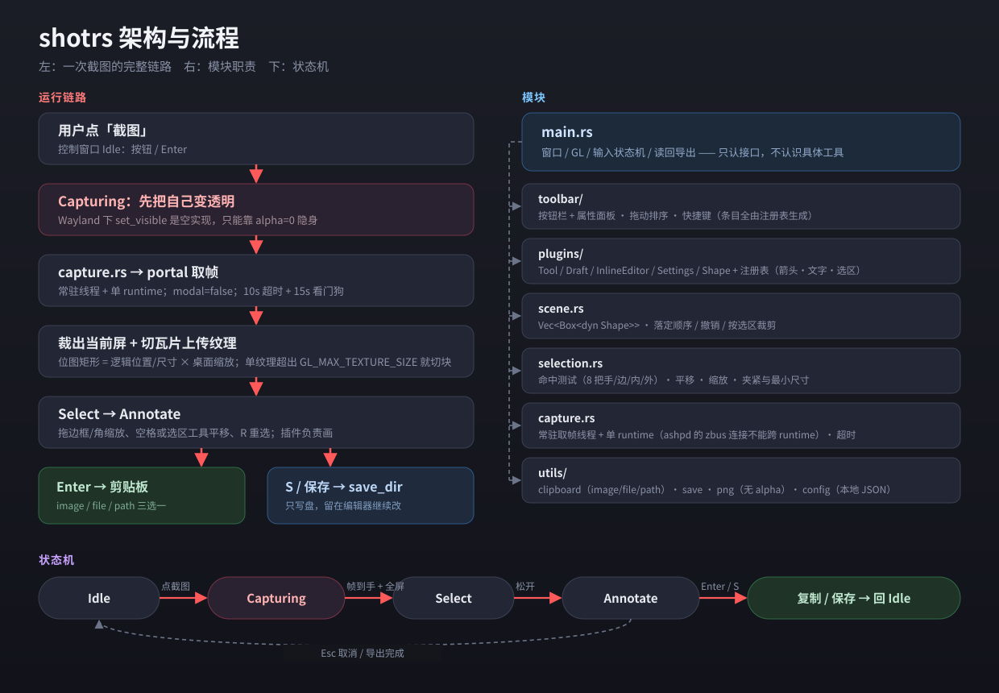

<p align="center">
  
</p>

# shotrs

截图工具的 **Rust 最小实现**：winit 单屏全屏窗口 + 自绘 OpenGL + egui 立即模式界面，
取帧走 `xdg-desktop-portal`，不依赖任何 GNOME 扩展。

它不是成品，是用来验证一条技术路线的：**GNOME Wayland 下，不写 shell 扩展也能做出顺手的截图工具**。

启动后是一个置顶小控制窗口，点「截图」才开始整条链路；收进顶部栏托盘后，靠全局快捷键随手截。

## 它验证什么

| # | 待验证 | 结论 |
|---|---|---|
| 1 | winit 能否开真正的单屏全屏窗口 | 能，画面正好铺满一块屏、无边框 |
| 2 | portal 取帧的延迟与分辨率 | 0.6–1s，返回整桌面位图（按会话最大缩放渲染，不是 1x） |
| 3 | GPU 合成下拖动是否还卡 | 不卡（右上角有 ms / fps，拖箭头时自查） |
| 4 | **fcitx5 中文输入能否用** | 能，`text-input-v3` 没问题 |

第 4 条最初是决定性的 —— 其余三条基本无悬念，只有这条可能在 winit 的 `text-input-v3` 实现上翻车。

## 能做什么

- **框选 + 标注**：箭头 / 矩形 / 椭圆 / 马赛克 / 文字，可选中、拖动、缩放、删除，撤回恢复 64 级；
  全屏截图后也能重新框选（右上角「重选」/ `Shift+R`，或直接在全屏选区上拖一块新的）
- **两拍导出**：`Enter` 只复制（同时宣告 PNG + BMP，RDP / VNC 友好），`S` 存盘并留在编辑器里继续改
- **常驻托盘**：小窗口收进顶部栏，全局快捷键（GNOME 自定义快捷键 → `shotrs --screenshot`）随时开拍；
  从托盘触发的截图，导完直接回托盘，不会再弹出控制窗口
- **多屏**：可指定截哪块屏（`跟随窗口` / 具体某块），混合分数缩放下裁剪依然对得上
- **插件式标注**：主程序不认识具体标注类型，加一个新工具只需在 `src/plugins/` 加个文件 + 注册一行

## 运行

```bash
cargo run --release
```

首次会编译 100 多个 crate，几分钟；之后是秒级。想要 dock 里有图标，再跑一次 `./assets/install-icon.sh`。

环境：GNOME + Wayland（本机 GNOME 50 实测）。需要 `xdg-desktop-portal-gnome`（取帧）和
Python GTK 3（多格式剪贴板，缺了会退回 BMP-only）。

## 操作

**小控制窗口**（无边框，拖动标题条可移动）

| 键 / 动作 | 作用 |
|---|---|
| 点「截图」/ `Enter` | 开始取帧 |
| 「截图屏幕」一行 | 截哪块屏：`跟随窗口` / `eDP-2` / `DP-2` …（写进配置，托盘菜单里也有同一项） |
| 标题条右侧 `—` | 收进托盘（销毁窗口、进程留后台） |
| 标题条右侧 `×` | 关闭：按「关闭按钮」选项决定 收进托盘 / 直接退出 |
| 「退出」按钮 / `Esc` | 退出程序 |

**全屏编辑器**

| 键 / 动作 | 作用 |
|---|---|
| 拖空白处 | 框选（标注阶段拖到选区外 = 直接重选一块） |
| 拖边框 / 角 | 缩放选区（八个把手，指针靠近时才显示；全屏时边框在屏幕边缘，抓取带自动加宽） |
| 拖选区内部 | 当前工具是「选区」时 = 平移；箭头/文字工具下按住 `空格` 也能平移 |
| 全屏选区下拖内部 | 直接当「重新框选」（全屏没有「外面」可拖，平移又会被夹回屏幕） |
| 右上角「重选」/ `Shift+R` | 清空选区、回到框选阶段，拖出一块新区域（单击仍是全屏） |
| 拖动选区内部（箭头/文字） | 用当前工具画 |
| 拖动已有标注 | 移动；拖它四角的手柄 = 缩放；点右上角「×」= 删除 |
| 工具栏 / `V` `A` `R` `E` `M` `T` | 切工具（选区 / 箭头 / 矩形 / 椭圆 / 马赛克 / 文字），按钮可拖动排序 |
| 工具栏下方属性面板 | 颜色 / 线宽 / 字号，只作用于之后新画的标注 |
| `Z` / `Shift+Z` / `Y` | 撤回 / 恢复 |
| `Backspace` / `Delete` | 删除当前选中的标注 |
| `Enter` | **只复制到剪贴板**，然后回小窗口（或回托盘，不落盘） |
| 右上角「保存」/ `S` | 存到配置里的保存目录，留在编辑器里可继续改 |
| `Esc` | 放弃本次截图（文字编辑中则取消输入） |

**托盘**：左键点图标 = 直接截一张；右键菜单 = `截图 / 截图屏幕 / 显示窗口 / 收进托盘 /
关闭时最小化到托盘 / 退出`。

**全局快捷键**：portal 的 GlobalShortcuts 对非沙箱应用不放行，所以走 GNOME 自己的绑定 ——
把控制窗口里那行命令（`.../shotrs --screenshot`）加到
**设置 → 键盘 → 自定义快捷键**，按下想要的组合键即可。同一条命令经 unix socket 转给已运行实例，
天然单实例。

## 架构



（源文件 `assets/architecture.svg`，PNG 版同名 `.png`。左边是一次截图的完整链路，右边是模块职责，
下面是状态机。）一句话版本：`Idle` → `Capturing`（隐身 + 取帧）→ `Select`（全屏框选）→ `Annotate`
→ 导出后回 `Idle`。

## 配置

`~/.config/shotrs/config.json`（也可以在控制窗口里改，改完即时写回）：

```json
{
  "save_dir": "/home/you/图片/shotrs",
  "close_to_tray": true,
  "hotkey": "CTRL+ALT+S",
  "clipboard_mode": "image",
  "clipboard_max_side": 1920,
  "capture_display": "DP-2"
}
```

`clipboard_mode` 取 `image` / `bitmap` / `file` / `path`，`clipboard_max_side` 为 0 表示原尺寸，
`capture_display` 为 `null` 表示跟随控制窗口所在的屏。配置坏掉只会退回默认值并打日志，不会让程序起不来。

## 已知限制

- 全局快捷键要靠 GNOME 的「自定义快捷键」绑命令，程序自己绑不上
- 截哪块屏只能显式指定（跟随窗口 / 菜单里选一块），没有「跟随鼠标」
- portal 取帧约 1s，是链路固有成本（要压掉得预热一条 PipeWire 常驻流）
- 滚动截图、OCR、录屏都没有

## 文档

| 文件 | 内容 |
|---|---|
| `AGENTS.md` | **工程文档**：架构细节、winit/portal 的坐标与缩放坑、插件协议、托盘与快捷键、调试开关、实测数据、自检与回归方式 |
| `assets/architecture.svg` | 链路 + 模块 + 状态机图 |
| `tools/remmina-x11.sh` | 用 XWayland 启动 Remmina，对照排查 RDP 剪贴板问题 |

自检一把最快的方式：

```bash
SHOTRS_SMOKE=1 ./target/release/shotrs   # 截一张 → 复制 → 退出
SHOTRS_DEMO=1 ./target/release/shotrs    # 合成输入跑完整套交互（插件回归）
```
